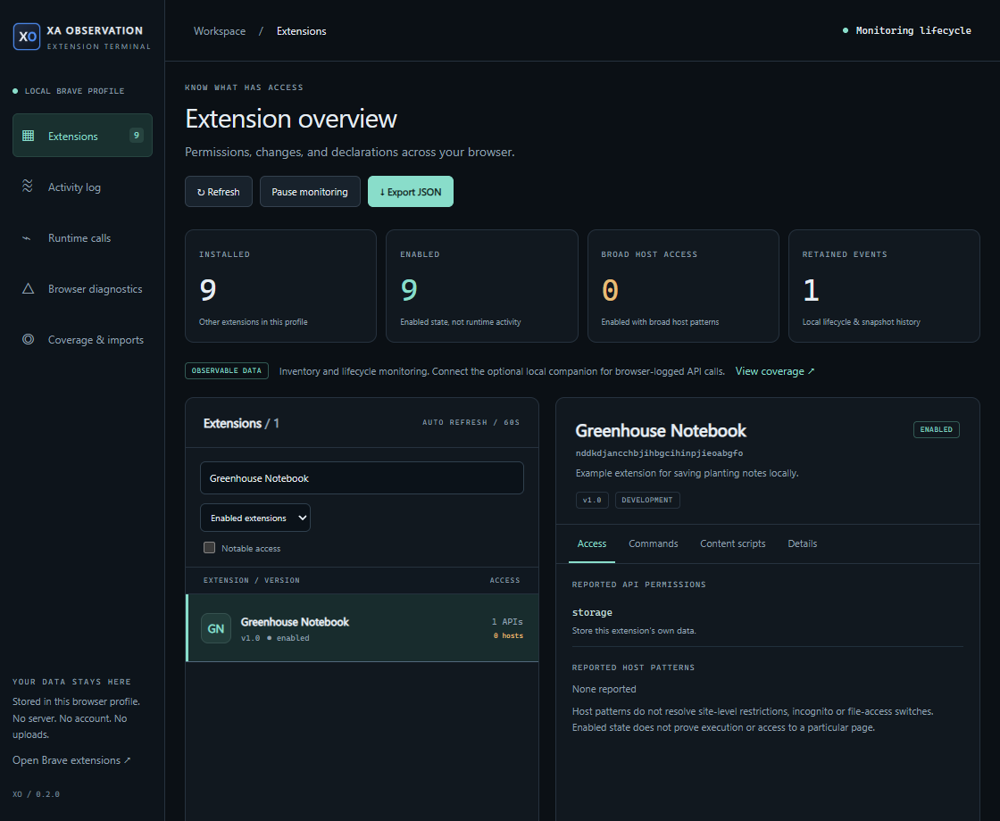

# XA Extension Observation

Inspect installed extensions, their permissions and host access, and their install, update, enable and disable history from a local dashboard.

In Brave, open `brave://extensions`, enable **Developer mode**, select **Load unpacked**, and choose this project’s [extension folder](extension/). Click **XO** to open the dashboard. Select an extension to inspect its access. Use **Activity log** to review changes or **Export JSON** to save a local copy.

**Browser diagnostics** can record navigation and reloads. Choose **Capture selected tab** to collect console errors and failed requests for one tab. For browser-logged extension API calls, enable the optional Windows companion. Its source logs can contain URLs and arguments. Setup, shutdown, retention and troubleshooting are in the [diagnostics guide](docs/diagnostics.md).
