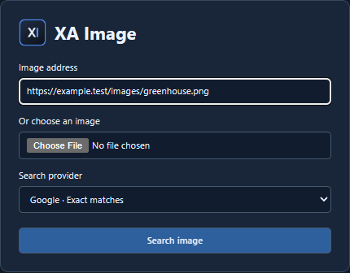

# XA Image

Search for an image from its browser context menu. XI supports Google Lens exact matches, Bing Visual Search, Yandex Images, TinEye and Baidu Images.

In Brave, open `brave://extensions`, enable **Developer mode**, select **Load unpacked**, and choose this project’s [extension folder](extension/). Right-click an image or thumbnail, choose **XA Image**, then select a provider. A thumbnail linking directly to an image file uses the linked original. Google opens Lens and XI selects **Exact matches** when available.

For a local file, click **XI**, choose the file and provider, then select **Search image**. For an image behind a login, try **Upload displayed image** from the context menu or choose a saved copy. The provider receives the image URL or bytes when you submit a search.
