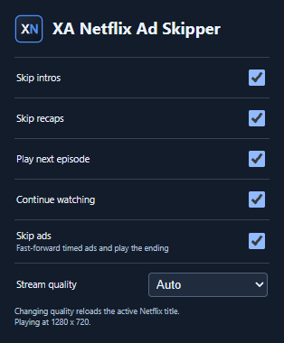

# XA Netflix Ad Skipper

Handle Netflix playback prompts automatically and fast-forward timed ads. The XN popup controls intros, recaps, the next episode, the continue-watching prompt and ads independently.

In Brave, open `brave://extensions`, enable **Developer mode**, select **Load unpacked**, and choose this project’s [extension folder](extension/). Refresh any open Netflix title, then click **XN**. All five switches start enabled. When XN reads an ad countdown it mutes and hides the accelerated portion, then restores playback before the ending. An unreadable countdown leaves the video at your usual speed.

**Stream quality** defaults to Auto. Changing the preference reloads the active title. XN can filter recognized stream lists, but the playing resolution depends on the player, plan and title. **Playing at** reports the video’s decoded dimensions. Live Netflix playback has not confirmed that selecting a resolution changes the stream.
