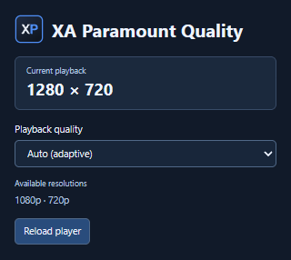

# XA Paramount Quality

Choose a preferred Paramount+ resolution and see the dimensions of the video currently playing. XP reads the resolutions and bitrates advertised by supported HLS and DASH streams.

In Brave, open `brave://extensions`, enable **Developer mode**, select **Load unpacked**, and choose this project’s [extension folder](extension/). Refresh an already-open Paramount+ tab. Start a title, open **XP**, select **Highest available** or a listed resolution, then click **Reload player**. **Auto (adaptive)** leaves the choice to the player.

If a title lacks the saved resolution, XP selects the nearest available height below it, or the lowest if every option is higher. The toolbar badge reports the decoded height. A title can report playback dimensions even when it exposes no quality list.
