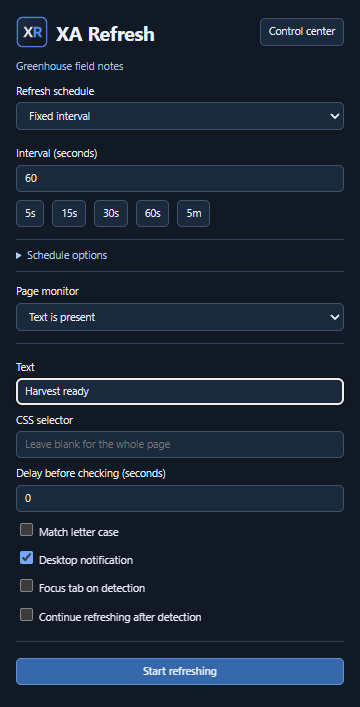

# XA Refresh

Schedule reloads per tab and optionally monitor a page for changed content, text or a CSS selector.

In Brave, open `brave://extensions`, enable **Developer mode**, select **Load unpacked**, and choose this project’s [extension folder](extension/). Open an HTTP or HTTPS page, click **XR**, choose a fixed interval, random interval or one-time refresh, then select **Start refreshing**. Use **Schedule options** to set a start time, limit the number of reloads, bypass cache or refresh only inactive tabs.

To reproduce the example, choose **Text is present**, enter `Harvest ready`, and enable **Desktop notification**. Starting a page monitor requests access to that site. Open **Control center** to inspect active timers and recent activity, or stop all timers.
