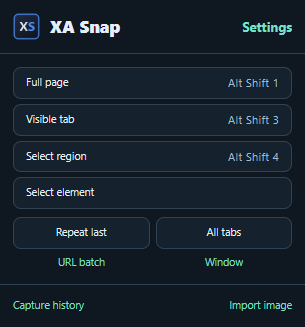
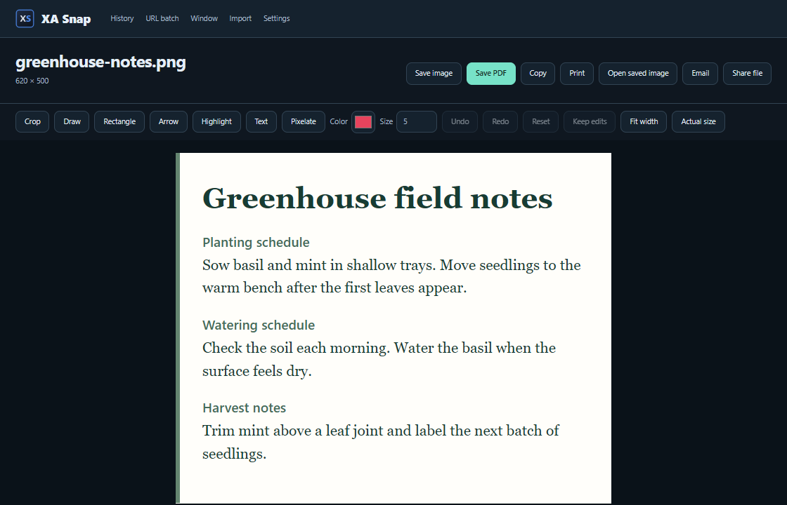

# XA Snap

Capture a full page, visible tab, region or element and annotate the result in XA Snap Studio. Capture history and file generation stay in the browser profile.

In Brave, open `brave://extensions`, enable **Developer mode**, select **Load unpacked**, and choose this project’s [extension folder](extension/). Open a page and click **XS** to choose a capture. Use **All tabs** or **URL batch** for a set of pages, **Window** for a browser-selected window, or **Import image** for an existing file.

In Studio, crop the image, add arrows, highlight text or pixelate a region. Export PNG, JPEG, WebP or PDF. Open **Capture history** to combine selected captures into one PDF. History can retain page titles and URLs alongside images. Review or delete entries from Studio.
