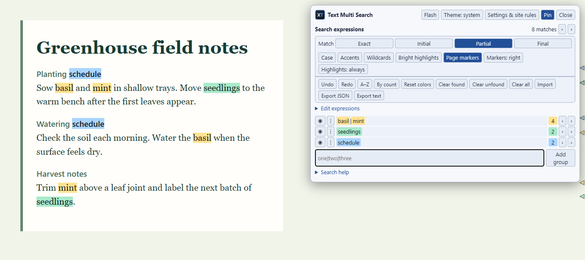

# XA Text Multi Search

Highlight several search groups on the same page and jump between their matches. Each group has its own color. Separate alternatives with a vertical bar, such as `basil|mint`.

In Brave, open `brave://extensions`, enable **Developer mode**, select **Load unpacked**, and choose this project’s [extension folder](extension/). Refresh an open page and click **XT**, or press **Ctrl+Shift+F** if assigned. Enter an expression and choose **Add group**. Use **Edit expressions** to enter multiple groups, one per line.

Use a group’s arrows to step through its matches. **Bright highlights** increases contrast, and the marker control moves the page markers between edges. **Settings & site rules** includes palettes, match behavior and site exclusions. Expressions, annotations and preferences stay in local browser storage.
