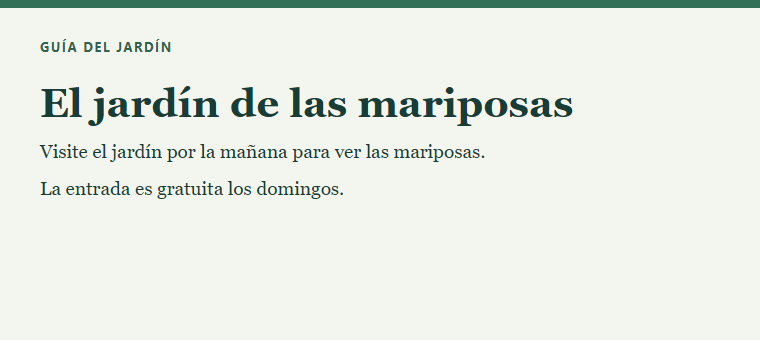
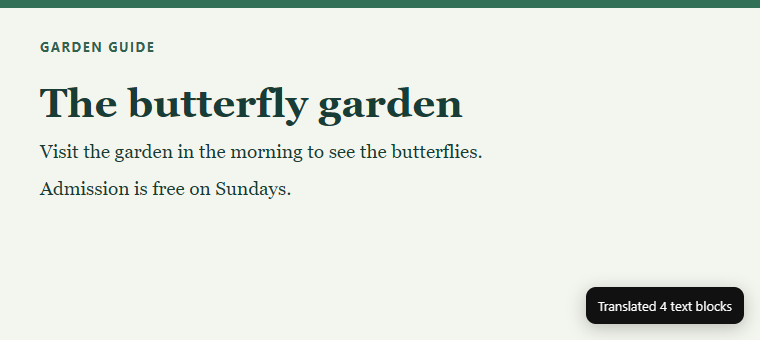
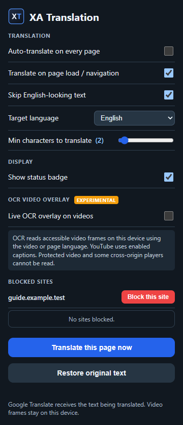

# XA Translation

XA Translation is a Brave and Chromium extension that translates text in place. It detects the source language and supports 18 target languages. English is the default target, and automatic translation starts turned off.

## Install in Brave

1. Open `brave://extensions` and enable **Developer mode**.
2. Select **Load unpacked** and choose the [extension folder](extension/) containing `manifest.json`.
3. Reload any webpages that were open during installation. Pin **XA Translation** from the extensions menu to keep the **XT** button on the toolbar.

## Translate a page

Open **XT**, choose a **Target language**, and click **Translate this page now**. The extension replaces eligible text on the page. Click **Restore original text** to switch back.

These screenshots show the same sample page in Brave. The status badge in the English version reports that the extension translated four text blocks.

| Original Spanish | Translated English |
| --- | --- |
|  |  |

## Popup controls

- **Auto-translate on every page** watches for new text as you browse. With **Translate on page load / navigation** enabled, it also scans when a page opens or the route changes.
- **Skip English-looking text** uses a character-based heuristic during automatic translation. If it skips a passage in another Latin-script language, click **Translate this page now** to bypass the heuristic.
- **Min characters to translate** sets the shortest eligible text block from 1 to 20 characters. The default is 2.
- **Show status badge** displays translation progress and results on the page.
- **Block this site** excludes the current hostname and its subdomains from translation. Remove the entry under **Blocked Sites** to allow translation again.

## Video captions and OCR

Enable **Live OCR overlay on videos** to translate text visible in accessible video frames. The bundled OCR engine uses the video or page language to read the text. On YouTube, turn on the video's own captions so the extension can translate them. Protected video and some cross-origin players prevent frame capture.

## Privacy

Google Translate receives the page text, caption text, or OCR text selected for translation. Video frames are processed on your device. The extension stores your preferences and blocked sites locally in your browser profile.
