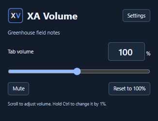

# XA Volume

Set volume independently for each browser tab. XV can boost quiet audio, mute a tab and restore its previous level.

In Brave, open `brave://extensions`, enable **Developer mode**, select **Load unpacked**, and choose this project’s [extension folder](extension/). Play audio in a tab and click **XV**. Drag the slider, enter a percentage or scroll inside the popup. Hold **Ctrl** while scrolling for one-percent steps. **Reset to 100%** releases the tab capture and restores ordinary playback.

Under **Settings**, choose the volume ceiling (100–999%, default 300%), whether to reset on navigation, and the popup theme. Audio processing runs locally through Web Audio.
