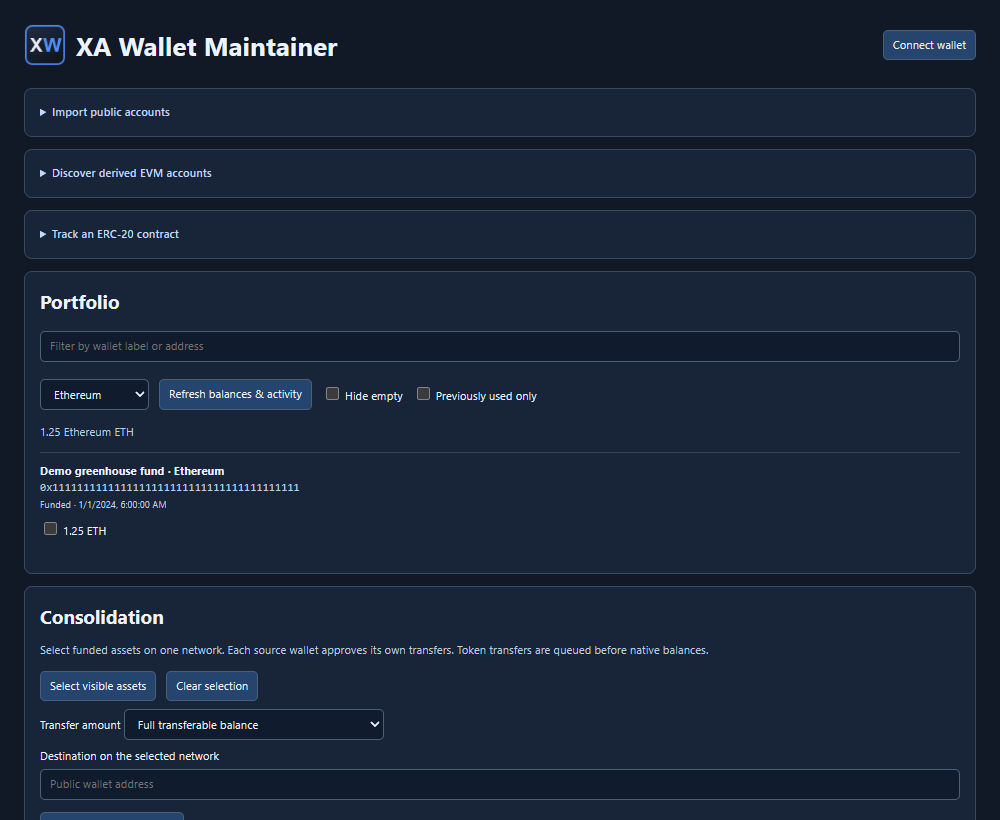

# XA Wallet Maintainer

Track public EVM and Solana accounts in one dashboard. Filter by network or wallet label, hide empty accounts, discover derived EVM addresses and review wallet-signed transfers.

In Brave, open `brave://extensions`, enable **Developer mode**, select **Load unpacked**, and choose this project’s [extension folder](extension/). Click **XW**, label and import public addresses, choose a network, then select **Refresh balances & activity**. The screenshot uses synthetic account data. Live scans send the selected public addresses to the configured RPC and indexing providers.

- **Connect a wallet.** On Windows, run `Start Wallet Connector.cmd` from the project folder and leave it open. Select **Connect wallet** and approve the accounts in your wallet. The bundled connector runs on loopback and requires Python.

- **Discover accounts.** A compatible account or external-chain EVM xpub derives the first 100 external addresses locally. Scan and import the addresses you want to track. For Solana, connect or paste public addresses.

- **Consolidate.** Select funded assets on one network, choose a destination and review each transfer’s amount and fees. Each source wallet approves its own transactions. Check confirmations before retrying an uncertain submission. The dashboard stores public account information locally and never needs a seed phrase.
